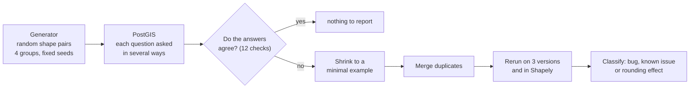

# Testing the consistency of spatial operations in PostGIS

Final project for MCET063 (Tópicos em Testes Automatizados e Verificação de Software, PPGPCA/UFFS,
2026-2), by Alexandre Zatti. This repository holds everything behind the experiments: the testing
tool, the protocol, the inputs, every run's raw results, and a tiny script for each problem found.
The paper is written separately and draws on what is here.

## In one paragraph

PostGIS answers spatial questions inside PostgreSQL, such as "does A contain B?" or "what is
the overlap of A and B?". Most of the geometry is computed by GEOS, a C++ library that Shapely,
QGIS and many other tools also use. When one of these answers is wrong, nothing warns the user.
There is no answer key to compare against, so this project asks each question in several ways
that must agree, and flags any disagreement. Random shape pairs are generated automatically
(fuzzing). Every disagreement is shrunk to a minimal example, rerun on three PostGIS/GEOS versions
and in Shapely, and classified. The project also measures whether deliberately awkward shapes
find more problems than ordinary random ones. Awkward shapes are ones that touch at a single
point, share an edge or contain an empty part.



## Results at a glance

| Step | What was done | Result |
|---|---|---|
| Calibration | 12 known GEOS bugs replayed; 964 cases from GEOS's own test suite as a false-alarm check | 4 of 12 caught by the check predicted in advance, 7 of 12 by some check; 0 false alarms |
| Pilot | 1,000 ordinary pairs | 0 problems |
| Main run | 640,000 pairs in 4 groups × 10 seeds | ordinary shapes: no real bug; awkward shapes: several (below) |
| Triage | 11,367 flags shrunk and merged | 399 unique minimal examples |

Flagged pairs per 10,000, range over the 10 seeds:

| | whole-number coordinates | decimal coordinates |
|---|---|---|
| ordinary shapes | 0 | 0 – 2.5 |
| awkward shapes | 5.6 – 12.5 | 332 – 363 |

What the 399 examples turned out to be:

| Problem | Examples | Status |
|---|---|---|
| GEOS crashes on a collection holding an empty polygon and two touching polygons | 254 | appears new; still present in the development version |
| "contains" gives a wrong answer for a point on the border plus an empty part, on the cached code path only | 58 | unreported variant of a cause GEOS fixed elsewhere in 2024 |
| Two known open GEOS issues | 31 | already reported upstream |
| A possible new problem with a hole touching its border | 1 pair | candidate, explained only by reading the code |
| One unexplained case | 1 | not counted |
| Rounding effects of decimal arithmetic | 53 | not bugs |

Decimal coordinates added only rounding flags. Once the two rounding-sensitive checks are left
out, awkward decimal and awkward whole-number shapes are flagged about equally often (139 vs
146 pairs). Details and caveats are in [docs/04-results.md](docs/04-results.md).

## Try it in five minutes

The crash can be seen with Python and Shapely alone, no database needed:

```bash
pip install shapely==2.2.0
python findings/A-relateng-crash-empty-polygon/reproduce.py
```

Every problem family has a folder in [findings/](findings/) with a Shapely script, the same check
in SQL, and the output we observed.

## Reproduce everything

[docs/05-reproduce.md](docs/05-reproduce.md) has the full steps. In short, there are three
levels of reproduction:

1. **Look at the problems:** run the scripts in `findings/`. Needs Python and Shapely only.
2. **Recompute every number:** download the main-run databases (2 GB) with
   `python scripts/fetch_e3_data.py`, then run the analysis scripts. Needs Python only.
3. **Rerun the experiments:** start the pinned PostGIS containers with Docker and run the
   calibration, the pilot, the main run and the triage. On the original 14-thread laptop, the
   main run took about 2¾ hours on 5 parallel databases.

## Where things are

```
README.md                         this page
docs/                             explanations, read in order
  01-background.md                PostGIS, GEOS, predicates, overlays, rounding, fuzzing
  02-method.md                    the 12 checks, the generator, triage, statistics
  03-experiments.md               the five steps as they were run, including what went wrong
  04-results.md                   all results, with their limits
  05-reproduce.md                 step-by-step reproduction
  experiment-plan.md              the protocol fixed before the runs, with dated amendments
tavs/                             the testing tool (Python package)
seeds/                            calibration inputs: known GEOS bugs and GEOS's test suite
runs/                             raw results and summaries of every run (see runs/README.md)
findings/                         one small reproducer per problem family
archive/triage-investigations/    exploratory scripts used to classify the findings
scripts/fetch_e3_data.py          downloads the main-run databases from the GitHub release
compose.yaml                      the three PostGIS versions, pinned by image digest
compose.lanes.yaml                throwaway databases for the parallel main run
requirements.txt                  Python packages, pinned
```

## Versions tested

| Role | PostgreSQL | PostGIS | GEOS |
|---|---|---|---|
| current (main target) | 18.6 | 3.6.4 | 3.14.1 |
| development | 18.6 | 3.7.0dev | 3.16.0dev |
| old (before GEOS rewrote its predicate engine) | 17.5 | 3.5.2 | 3.9.0 |
| Shapely 2.2.0 (calls GEOS directly) | – | – | 3.14.1 |

All runs took place on 2026-10-27 and 2026-10-28. The images are pinned by digest, so the same
code runs again on exactly the same versions.

## Notes

- This repository is private. Nothing here has been reported upstream.
- `seeds/geos-xml/` contains test files copied from GEOS (LGPL-2.1), and `seeds/raw/` holds
  copies of public GEOS issue pages used to build the calibration set.
- No license has been chosen yet, so all rights are reserved by default.
