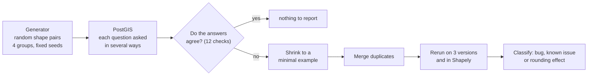

# Testing the consistency of spatial operations in PostGIS

Final project for MCET063 (Tópicos em Testes Automatizados e Verificação de Software, PPGPCA/UFFS,
2026-2) by Alexandre Zatti, Arthur Antonio Bertoglio and Davi Augusto Marangoni Mocva. This
repository holds everything behind the experiments: the testing tool, the protocol, the inputs,
every run's raw results, and a small script for each problem found.

## In one paragraph

PostGIS answers spatial questions inside PostgreSQL, such as "does A contain B?" or "what is
the overlap of A and B?". Most of the geometry is computed by GEOS, a C++ library that Shapely,
QGIS and many other tools also use. When one of these answers is wrong, nothing warns the user.
There is no answer key to compare against, so this project asks each question in several ways
that must agree, and flags any disagreement. Random shape pairs are generated automatically
(fuzzing). Disagreements and crashes are grouped by kind, and up to 400 representatives are shrunk
to minimal examples, rerun on three PostGIS/GEOS versions and in Shapely, and classified. The
project also measures whether deliberately awkward shapes (touching at a single point, sharing an
edge, containing an empty part) find more problems than ordinary random ones.



## Results at a glance

| Step | What was done | Result |
|---|---|---|
| Calibration | 13 known GEOS problems replayed, 12 with a clear verdict; 964 cases from GEOS's own test suite as a false-alarm check | 4 of 12 caught by the check predicted in advance; 6 of 12 by some check (10 of 12 when the development version, which already answers four of them correctly, counts as their bug-free version); 0 false alarms |
| Pilot | 1,000 ordinary pairs | 0 problems |
| Main run | 640,000 pairs in 4 groups × 10 seeds | ordinary shapes: no real bug; awkward shapes: several (below) |
| Triage | 11,367 flags from 5,667 flagged pairs and 176 crashing pairs; 400 representatives shrunk | 399 unique minimal examples |

Flagged pairs per 10,000, range over the 10 seeds (crashes are counted separately, not here):

| | whole-number coordinates | decimal coordinates |
|---|---|---|
| ordinary shapes | 0 | 0 – 2.5 |
| awkward shapes | 5.6 – 12.5 | 332 – 363 |

| Problem | Examples | Status |
|---|---|---|
| GEOS crashes on a collection holding an empty polygon and two touching polygons | 254 | appears new; still present in the development version |
| "contains" gives a wrong answer for a point on the border plus an empty part, on the cached code path only | 58 | unreported variant of a cause GEOS fixed elsewhere in 2024 |
| Wrong answers consistent with two known open GEOS issues | 31 | already reported upstream |
| A possible problem with a hole touching its border | 1 pair | candidate, explained only by reading the code |
| One unexplained case | 1 | not counted |
| Rounding or snapping effects of decimal arithmetic | 53 | judged not bugs |

Details and caveats are in [docs/04-results.md](docs/04-results.md).

## Reproduce

Step by step in [docs/05-reproduce.md](docs/05-reproduce.md), at three levels:

1. **See the problems:** run the scripts in `findings/` (Python and Shapely only).
2. **Recompute every number:** `python scripts/fetch_e3_data.py` downloads the main-run databases
   (296 MB, 2.1 GB unpacked), then the analysis scripts rerun.
3. **Rerun the experiments:** pinned PostGIS containers with Docker.

## Where things are

```
docs/                             explanations, read in order
  01-background.md                PostGIS, GEOS, predicates, overlays, rounding, fuzzing
  02-method.md                    the 12 checks, the generator, triage, statistics
  03-experiments.md               the five steps as they were run, including what went wrong
  04-results.md                   all results, with their limits
  05-reproduce.md                 step-by-step reproduction
  experiment-plan.md              the protocol fixed before the runs, with dated amendments
tavs/                             the testing tool (Python package)
seeds/                            calibration inputs: known GEOS bugs and GEOS's test suite (LGPL-2.1)
runs/                             raw results and summaries of every run
findings/                         one small reproducer per problem family
archive/triage-investigations/    exploratory scripts used to classify the findings
scripts/fetch_e3_data.py          downloads the main-run databases from the GitHub release
compose.yaml                      the three PostGIS versions, pinned by image digest
```

AI disclosure: AI assistants helped design, code, run and document these experiments; the
authors are responsible for the content.
