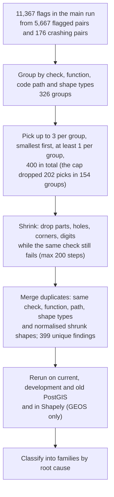

# 2. Method

The method has three parts. **Checks** decide whether PostGIS's answers on a pair of shapes are
consistent. A **generator** produces the pairs. **Triage** turns thousands of flags into a short
list of explained problems. The binding text is the protocol,
[experiment-plan.md](experiment-plan.md). This page explains it in plain words.

## Research questions

1. **RQ1.** Which consistency checks flag wrong or inconsistent results in current PostGIS/GEOS,
   on which inputs? Does each flag turn out to be a real defect, a disagreement between code
   paths, or a rounding effect?
2. **RQ2.** With the same number of test pairs, do awkward (degenerate) shapes find more than
   ordinary random shapes, for both whole-number and decimal coordinates?
3. **RQ3.** Do the checks catch known bugs on a version that has them, and stay quiet where
   nothing is wrong?

## The 12 checks

Each check is a relation that must hold whatever the right answer is. For example, nobody needs
to know whether A contains B to know that "A contains B" must equal "B within A".

**Strict** checks must hold exactly, so a strict violation is a defect or a path inconsistency.
**Candidate** checks are those where rounding may legitimately interfere. The tier is decided per
pair from its coordinates. Predicate checks (R1–R4) are strict when all coordinates are whole
numbers and the pair spans less than 2^20 units; overlay checks (R5–R12) also need every
coordinate below 2^20. Otherwise they are candidates. A candidate yes/no check has no size to
compare with a tolerance, so any disagreement counts as a flag and goes to triage. The checks
that measure a size get a tolerance (below).

### Predicate checks (yes/no questions)

| Code | Check in plain words | Why it must hold |
|---|---|---|
| R1 | Each named predicate (Contains, Covers, Touches...) equals its pattern on the relationship matrix | That is how each predicate is defined |
| R2 | Logic between predicates: Contains ⇒ Covers ⇒ Intersects; Within(a,b) = Contains(b,a); Intersects, Touches and Equals are symmetric; Disjoint = not Intersects; `ST_Relate(b,a)` is the transpose of `ST_Relate(a,b)` | Definitions again; swapping the arguments swaps the rows and columns of the matrix |
| R3 | The same predicate gives the same answer as a direct call, with a prepared first argument, with a prepared second argument, and inside an index join | The question is the same, only the route differs |
| R4 | Wrapping either argument in a collection does not change the answer | A shape and a collection holding only that shape are the same point set |

### Overlay checks (shapes built from two shapes)

| Code | Check in plain words | Why it must hold |
|---|---|---|
| R5 | A and B intersect exactly when their intersection is not empty | Same fact computed two ways (predicate engine vs overlay engine) |
| R6 | The union of a non-empty A is not empty, and overlay results are valid shapes | Union only adds |
| R7 | The intersection lies inside A (and B), and A lies inside the union | Set logic |
| R8 | Intersection(A,B) equals Intersection(B,A), same for Union | Argument order does not matter |
| R9 | size(A ∪ B) = size(A) + size(B) − size(A ∩ B) | Inclusion–exclusion, with size = area for polygons and length for lines |
| R10 | The dimension of the intersection matches the matrix: if the matrix says the interiors meet over an area, the intersection is an area, not a line | Predicate engine and overlay engine must agree |
| R11 | The floating-point overlay and the overlay on a fine fixed grid have nearly the same size | Two precisions of the same operation |
| R12 | For 32 random points away from all boundaries: the point is in A ∩ B exactly when it is in A and in B, and in A ∪ B exactly when it is in A or in B | Set logic, checked with a different algorithm (point-in-polygon) |

R7, R8, R9 and R11 measure a size, so they need a tolerance. It was fixed before the pilot and
never changed. Each measured difference is classed *noise*, *logged* or *triage*. Only *triage*
counts as a violation. The tolerance scales with the shapes' size and coordinate magnitude. When
a pair is too small to measure at its magnitude, it is marked *precision-limited*: these four
measured checks do not count on it, while the strict checks and the yes/no checks still do.

In these pages a **flag** is one counted violation of one check on one pair, or one crash. A
**flagged pair** is a pair with at least one counted violation; it counts once however many
checks it fails.

## The generator

The four groups below are called *arms*, as in a clinical trial.

| | whole numbers (`int`) | decimals (`float`) |
|---|---|---|
| ordinary shapes | **plain-int** | **plain-float** |
| awkward shapes | **degen-int** | **degen-float** |

**Base pair.** Two random shapes on an integer grid up to 2^20, 10 to 1,000 units across, usually
overlapping. Polygons are star-shaped with 3–12 corners and up to 2 holes. Lines have 2–8 corners.
Multi-shapes have 1–3 parts. Collections are used for predicates only. Invalid draws are
redrawn and counted.

**Awkward moves** ("degenerate"). One or two of these are added to the base pair:
- a shared corner;
- a corner exactly on the other shape's edge;
- overlapping collinear edges;
- a hole touching the outer border;
- a sliver or spike one unit wide;
- parts of a multipolygon touching at a point;
- empty parts;
- collections made only of points.

These cases are where geometry code is most fragile.

**Decimal versions.** One transformation per pair is applied to both shapes. The data uses five
labels:
- `affine`: an affine map with full-precision digits;
- `rotation`: a rotation;
- `scale-2^-k`: an exact scaling down by a power of two, to about 1e-8;
- `translate-1e15` (predicate pairs) and `translate-2^27` (overlay pairs): a shift by a
  whole-number offset. Overlay pairs get the smaller shift because at 1e15 the overlay engine's
  legitimate snapping moves points by more than the shapes' size.

Both shifts keep whole numbers whole, so a translated pair is "decimal" only by its arm. That is
why the tier is computed per pair and never assumed from the arm. About one plain-float pair in
four (40,138 of 160,000) is strict for the predicate checks but a candidate for the overlay
checks.

In the awkward decimal arm, slivers and spikes are added *after* the transformation, at the same
place as in the whole-number arm. There they are one unit wide; here they are one to eight
rounding steps wide (k·ulp(M), k in {1, 2, 4, 8}, where ulp(M) is the gap between neighbouring
doubles at the pair's largest coordinate). This keeps the thin-sliver trigger of a known GEOS
issue present under every transformation.

**Paired design.** All four arms are built from the same base pair, identified by seed, kind and
index. plain-int is the base pair, and degen-int is the base plus the moves. plain-float and
degen-float apply the same transformation to those two (with degen-float's slivers rebuilt at the
decimal scale, as above). Differences between arms therefore come from the treatment, not from
luck in drawing different pairs.

**Seeds.** Every pair is replayable from its seed number. The seeds were fixed before any run:
seed 100 for the pilot, seeds 101–110 for the main run. Seeds below 100 were for development.

## Triage

- Crashes are rerun in throwaway containers, because a crash takes the database process down.
- Shapely runs in a separate process for the same reason.
- A *finding* is one shrunk example for one check and function, not one bug. The same shrunk
  input can appear twice, for example once for Intersection and once for Union. Many findings
  can share one root cause, so the final classification groups them into *families* (A to G, see
  [04-results.md](04-results.md)).
- The possible classes are:
  - new defect;
  - unreported variant of a known cause;
  - consistent with a known open issue;
  - candidate;
  - unresolved;
  - rounding effect (not a bug).

## Measures and statistics

- **Primary measure:** flagged pairs per 10,000, per seed and arm. A pair counts once however
  many checks it fails. Crashes are not violations: they are counted separately, and after a
  crash the remaining calls of that SQL function on that pair are skipped.
- **Comparisons:** four planned contrasts:
  - awkward vs ordinary, within whole numbers;
  - awkward vs ordinary, within decimals;
  - decimal vs whole number, within ordinary shapes;
  - decimal vs whole number, within awkward shapes.
- **Test:** the exact Wilcoxon signed-rank test over the 10 seeds, paired by seed, with a Holm
  correction for running four tests and the rank-biserial correlation as effect size. With 10
  seeds the smallest possible two-sided p-value is 2/1024 ≈ 0.002, reached when every seed moves
  the same way. The protocol says an arm that is zero in every seed is reported as counts, not
  tested.
- **Secondary measures:** unique findings per arm, rates per check, classes, and run times.
- Analyses decided after seeing the results are labelled exploratory.

## The tool (`tavs/`)

| Module | Role |
|---|---|
| `gen.py` | the seeded generator for the four arms |
| `gen_check.py` | self-check of the generator and shrinker |
| `rules.py` | the 12 checks, written as SQL plus Python comparisons |
| `db.py` | connections to the PostGIS containers, with timeouts and crash handling |
| `store.py`, `pair.py` | the SQLite results store and the pair record |
| `e1.py` | the calibration run on known bugs and GEOS's test suite |
| `campaign.py` | the pilot and main-run runner, in parallel lanes, resumable |
| `analysis.py` | the primary measure, contrasts and descriptive tables |
| `shrink.py` | the shrinker |
| `triage.py`, `triage_shapely.py` | triage: selection, shrinking, dedup, reruns, Shapely check |
| `families.py` | the final family and class for each finding |
| `posthoc.py`, `posthoc_checks.py` | exploratory analyses decided after the results |
