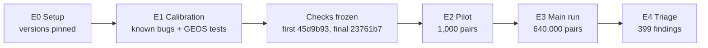

# 3. The experiments as they were run

There were five steps, E0 to E4, all run on one Windows laptop (14 threads, 16 GB RAM) with Docker,
on 2026-10-27 and 2026-10-28. Each step had a gate that had to pass before the next one started.
Problems met along the way are recorded here, not hidden. Commands are run from the repository
root; [05-reproduce.md](05-reproduce.md) explains the setup.



## E0. Setup

- Three PostGIS Docker images were pinned by digest (`compose.yaml`) and their versions recorded:
  current 3.6.4 with GEOS 3.14.1, development 3.7.0dev with GEOS 3.16.0dev, and old 3.5.2 with
  GEOS 3.9.0.
- The tool was written: checks, generator, shrinker and results store.
- `rules.py` was checked independently before freezing. The check found several problems, which
  were fixed, and R12 was added because R9 can be wrong in the same way as the overlays it checks.

## E1. Calibration on known bugs (RQ3)

**Question:** do the checks fire on known bugs, and stay silent on correct cases?

**Inputs.**
- 13 known problems, each with a reproducer: 12 GEOS tracker items and one test from an unmerged
  GEOS pull request (`tangent-hole`). Not all are confirmed bugs: one is a rounding limitation by
  the maintainer's account and one is unconfirmed by the maintainers. Before running, we wrote
  down which check should fire on which version
  ([seeds/e1_preregistration.json](../seeds/e1_preregistration.json)). One item (#1027) got no
  verdict, so the counts below are out of 12.
- 964 shape pairs from GEOS's own test suite ([seeds/geos-xml/](../seeds/geos-xml/)) as a
  false-alarm test. GEOS asserts the right answers for these.

**Command:** `python -s -m tavs.e1` (about 80 seconds). It writes its database to
`runs/tavs.sqlite` and the summaries to `runs/e1/`; the committed `runs/e1/tavs.sqlite` is the
primary run's database, copied there.

**Result of the primary run:**
- 4 of 12 caught by exactly the checks predicted in advance (rule level, in `runs/e1/summary.md`).
- 6 of 12 caught by some counted check, with no check firing on the version without the bug
  (suite level). Counting only strict and measured checks: 5 of 12.
- Four of the bugs (#1342, #1343, #1344, #1354) already get the right answer on the development
  version, which the pre-registration treated as buggy. Taking it as their bug-free version gives 10 of
  12 (9 with strict and measured checks only).
- 0 of the 964 GEOS test pairs flagged.
- The suite-level counts come from `python -s -m tavs.e1_detection runs/e1`.

**Runs, in order** (all kept in `runs/`):

| Folder | What it was |
|---|---|
| `e1-first`, `e1-second-superseded` | first runs, which exposed problems in the checks |
| `e1-prefreeze` | last run before the checks were frozen; its findings drove the dated amendments in the protocol |
| `e1-freeze1` | first run with frozen checks (first freeze, commit 45d9b93). It showed that line overlays need a distance-based tolerance, which was the one amendment made after the freeze, before the pilot |
| `e1` | **primary run**, final checks (commit 23761b7) |

Some of the calibration bugs shaped the amendments, so part of the calibration result is
in-sample. The paper reports this.

## E2. Pilot

**Question:** do ordinary shapes with whole-number coordinates produce any strict violations?
The protocol required zero, or each one explained, before the main run.

**Command:**
```
python -s -m tavs.campaign run --campaign e2 --seeds 100 --kinds predicate overlay --n 500 --arms plain-int --lanes 1
```

**Result:** 1,000 pairs in about one minute (about 57,500 pairs per hour on one database), 0
violations, 0 crashes. The gate passed, and the pilot's speed set the main run's size.

## E3. Main run (RQ1, RQ2)

**Command:**
```
python -s -m tavs.campaign run --campaign e3 --seeds 101-110 --kinds predicate overlay --n 8000 --lanes 5
```

**Size:** 10 seeds × 2 kinds (predicate and overlay pairs) × 8,000 indices × 4 arms = 640,000
pairs, with every check run on every pair. Five throwaway PostgreSQL containers
(`compose.lanes.yaml`) ran in parallel, two seeds each.

**What happened:**
- **16:39:** start.
- **17:27:** about 37% done. A low-memory guard running on the laptop (not part of this tool)
  stopped the run, because Windows had about 3.2 GB free. The results so far were stored.
- **17:50:** restart. The runner resumes without duplicates.
- **19:24:** finished, with 0 harness errors and 0 duplicate pairs.
- About 52,000 pairs per hour per lane. The 2¾ hours from start to finish include the
  23-minute stop.

**Crashes:** 677 crash events in 176 pairs, all in the awkward arms, cost about 9% of lane time.
When a SQL function crashed the database, the runner reconnected, recorded the crash, and skipped
that function for the rest of the pair. The crash itself was first seen during development
(seed 1, index 507), before the main run; the main run measured how often it occurs.

**Analysis:** `python -s -m tavs.analysis --campaign e3` writes `runs/e3/analysis/`.

**Observation after the results:** almost all decimal-arm flags came from one candidate check
(R11) on line pairs, under affine and rotation transforms. Triage later showed that the check
was mostly flagging its own fixed-grid reference. The frozen checks and the registered analysis
were not changed. Extra, exploratory analyses were added and labelled as such
(`python -s -m tavs.posthoc runs/e3`, `python -s -m tavs.posthoc_checks runs/e3`).

## E4. Triage

**Command:** `python -s -m tavs.triage --campaign e3 --cap 400`

**First attempt** (`runs/e3_triage_console_run1.txt`): most crashes in the main run happened in
the wrapped form of the call (one argument passed through `ST_ForceCollection`, check R4). The
crash replay tried only the plain call, so 80 crash items wrongly read "not reproduced". The
replay was fixed to try both wrapped forms (commit 050b8fb). Those 80 records were discarded and
triage resumed (`runs/e3_triage_console.txt`).

**Result** (finished 2026-10-27 23:46):
- 11,367 flags were grouped into 326 groups, and 400 representatives were picked. The cap of
  400 dropped 202 further picks in 154 groups.
- All 400 reproduced on the current version.
- Shrinking and deduplication (same check, function, path, shape types and normalised shrunk
  shapes) left 399 unique findings.
- Each was rerun on the three versions and in Shapely.

**Classification** (2026-10-28):
- The crash, predicate and overlay findings were investigated separately: reading the GEOS
  source, exact rational arithmetic to decide which answer is right, and tracker searches
  ([archive/triage-investigations/](../archive/triage-investigations/)).
- An independent challenge then narrowed several labels.
- The final family and class of each finding are in `runs/e3/triage/families.csv`, written by
  `python -s -m tavs.families runs/e3`.

## Code versions

| Commit | Step |
|---|---|
| 399c631 | images pinned |
| 304c5ff | tool, checks R1–R11, generators, shrinker, calibration inputs |
| ba83e25, 5f90a68 | paired generators, decimal transformations |
| 641a8ef | fixes after the independent check, R12 added |
| 79c8267, 45d9b93 | crash handling, index join per lane; 45d9b93 is the first freeze |
| e891122, c2ab4cd | campaign runner and analysis |
| 23761b7 | final checks after the one amendment (line-overlay tolerance); primary calibration, pilot and main run |
| 4f4e867 | triage |
| 050b8fb | triage crash-replay fix; exploratory analyses |
| 6a0aacd | final classes by family |
